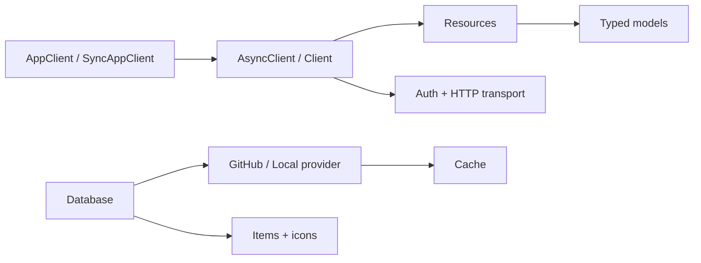

# stalzone-api

## A Python toolkit for the Stalzone API and Stalcraft item database


An approachable facade for quick scripts, with a typed sync/async client
underneath when you need more control.

[:material-download: Install the package](installation.md){ .md-button .md-button--primary }
[:material-book-open-variant: Explore the API](clients-and-api.md){ .md-button }

!!! tip "Start in seconds"
    ```bash
    python -m pip install stalzone-api
    ```

## Choose your path

<div class="grid cards" markdown>

-   :material-lightning-bolt:{ .feature-icon } **Quick start**

    Use a small, friendly facade for profiles, emission, auctions, clans, and
    operation sessions.

    **`AppClient`** for async · **`SyncAppClient`** for sync

    [See installation →](installation.md)

-   :material-api:{ .feature-icon } **Full API access**

    Use explicit resources, pagination iterators, custom transports, and raw
    endpoint requests.

    **`AsyncClient`** and **`Client`**

    [Browse clients and endpoints →](clients-and-api.md)

-   :material-shield-key:{ .feature-icon } **Authentication**

    Configure bearer tokens or application credentials, or use the OAuth
    helpers for token flows.

    [Configure authentication →](authentication.md)

-   :material-database:{ .feature-icon } **Item database**

    Read typed item data, search localized names, cache GitHub reads, or work
    from a complete local snapshot.

    [Explore the database API →](database.md)

</div>

## Your first request

=== "Async"

    ```python
    import asyncio
    from stalzone_api import AppClient

    async def main():
        async with AppClient() as client:
            profile = await client.profile("ZIV")
            lots = await client.auction("zyv9").lots(limit=3)
            print(profile)
            for lot in lots:
                print(lot)

    asyncio.run(main())
    ```

=== "Synchronous"

    ```python
    from stalzone_api import SyncAppClient

    with SyncAppClient() as client:
        print(client.profile("ZIV"))
        for lot in client.auction("zyv9").lots(limit=3):
            print(lot)
    ```

By default, the simple clients read credentials from the environment and use
the public demo API when no credentials are configured. For production, use
credentials issued for your application and keep them out of source control.
See [authentication](authentication.md) for the exact lookup order.

## How the pieces fit



## Guides

| Guide | What you'll find |
| --- | --- |
| [Installation](installation.md) | Requirements, install options, and imports |
| [Clients and API](clients-and-api.md) | Client selection, endpoints, options, and paths |
| [Authentication](authentication.md) | Credentials, OAuth, and token safety |
| [Item database](database.md) | Providers, items, search, icons, and cache |
| [Models and errors](models-and-errors.md) | Typed responses, pagination, retries, and exceptions |
| [Code analysis](analysis.md) | Architecture, review findings, and verification |
| [Development](development.md) | Tests, project layout, builds, and releases |
| [Changelog](changelog.md) | Release history |

!!! warning "Unofficial project"
    Stalcraft, Stalzone, the API, and the official item database belong to
    EXBO and their respective rights-holders. Availability, response schemas,
    and rate limits are controlled by those services.
